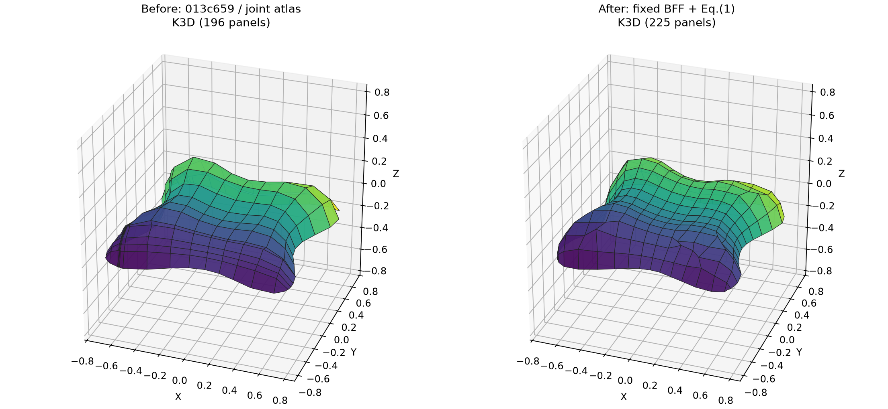
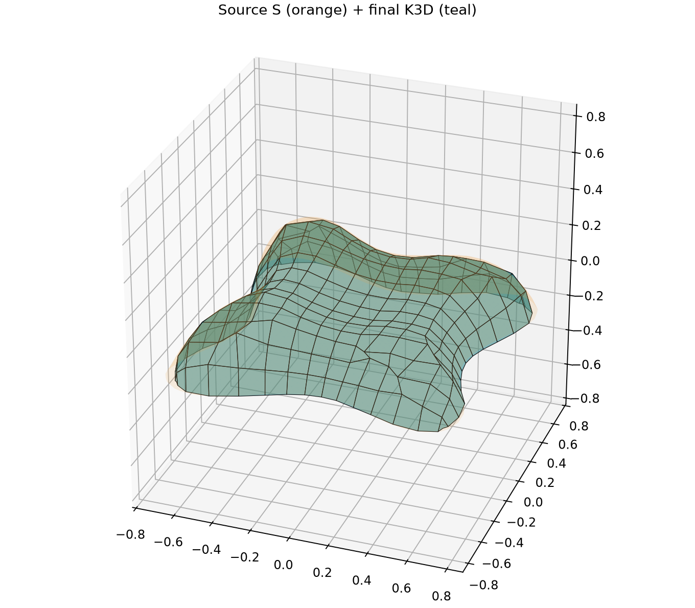
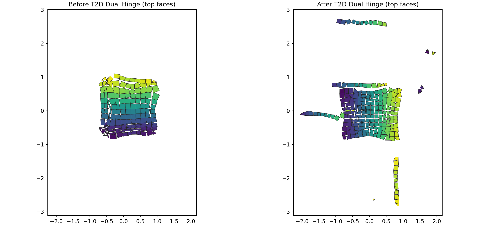

# Split後の形状破綻の修正と実測（2026-10-15）

対象は `agent/postcut-rebff-mac-20261014` の取得時HEAD `013c659b8f4f1774c6125e83dd699e63ed8e7a03`。
修正ブランチは `codex/k3d-geometry-fix-20261015`。OptCutsと通常モードの数値実装は変更していない。

## 結果と限界

実装を変更し、実メッシュをS→M2D→M3D→K3D→T3D→K2D→T2D Dual Hingeまで実行した。
再帰Splitが極細セルを作る問題と、押出し後に共有境界が離れる問題を再現・修正した。
ただし、論文の完全再現／製造可能性の検証完了ではない。CSF>2とT2D衝突が残り、表面適合の一部の指標は悪化している。

入力は `lilium.obj`、3389頂点・6590三角形。
SHA-256: `4f62ff741b41bd629ccbeaeb0bb2e44ac060cdff88f090129911bede790e8ab3`。
これは保存ログの最新実行の頂点数と一致し、添付画像に見られる細帯と境界のずれを再現した。
ただし添付画像には入力名・全設定の保存データがないため、**添付画像と完全に同一の実行だったことまでは確認できない**。

比較条件: grid=15、最大Split=8、初期矩形四隅=`source_boundary_shape_fit`、thickness=0.08、
K3D重み=(10000,10,0.1)、K2D重み=(1,1,0.001)、Dual Hinge=700反復・30秒設定・6再開始・seed=0。
CLIは09-23ランチャーの数値パッチを読み込み、ウィジェットを起動せず実行する。
両方ともCSF未達の診断実行として実行した。厚さ・衝突重み・CSF閾値を改善のために変更してはいない。

|指標|修正前|修正後|
|---|---:|---:|
|パネル数|196|225|
|M2D 最長辺/最短辺 最大|21.2404|1.00883|
|M3D 最長辺/最短辺 最大|22.3042|1.86464|
|最終K3D 最長辺/最短辺 最大|23.6473|3.45127|
|最終K3D 同指標95%点|22.1226|2.02762|
|最終K3D 平面からの距離 最大|0.00569010|0.000728325|
|最終K3D 平面からの距離 RMS|0.00161471|0.000172226|
|最終K3D Split対応頂点の最大離隔|0.0493358|0|
|最終K3D 頂点→入力三角形 距離RMS|0.00799012|0.0159174|
|最終K3D 頂点→入力三角形 距離最大|0.0483251|0.0465679|
|入力三角形中心512標本→K3D 距離RMS|0.0127486|0.0129064|
|パネル中心→入力三角形 距離RMS|0.0130654|0.0150960|
|T2D 上下面の凸包footprint衝突ペア|378|217|
|T2D footprint最大侵入深さ|0.0976652|0.0751731|
|T2D footprint侵入深さRMS|0.0240292|0.00835618|
|T2D 8頂点凸体の衝突ペア|346|168|
|T3D→T2D 全頂点間距離の最大変化|4.05e-15|5.69e-16|
|最大領域CSF比|2.59131|2.37264|
|矩形Ωの面積被覆率|100%|100%|

距離は入力メッシュの座標単位。入力bbox対角長は2.1818512。
平面誤差は各quadの最小二乗平面から4頂点までの距離。
頂点の表面距離は全入力三角形に対する最近点を探索し、近傍頂点への距離ではない。
512標本は決定的に選んだ三角形の中心であり、連続Hausdorff距離の保証ではない。
衝突数は保存済み最終頂点から同一の検出器で再計測した。旧版の保存済みcollision metricsは後述の後移動により古くなっているので比較に使っていない。
詳細値は [before.json](k3d_geometry_20261015/before.json) / [after.json](k3d_geometry_20261015/after.json)。





T2Dは同一縮尺で表示。物理Split後の離れた部品も実際のソルバー配置のまま表示しており、画像を整えるための再配置は行っていない。
パネル数が変わるため、旧138番と新138番は同じ物理領域とは限らない。

## 最初に破綻する段階

1. **M2Dの格子生成。** `candidate_lines` は各子領域の幅からspacingを再計算していた。
   古い切断線と新しい格子が近接し、幅0.00483067の帯を作った。その後の `choose_exact_grid` は元のタイル数に近づける目的でpitchを0.1026053へ変更し、最大辺長比21.24のセルを生成した。
   修正版は初期spacing=0.07252685262をSplit候補にも最終タイル化にも使用する。パネル数は密度合わせで再調整しない。
2. **逆写像そのものは今回の主因ではない。** 両版ともUV round-trip誤差最大2.48e-16、M3D頂点→S距離最大2.22e-16以下。
   M2Dの細帯がそのままM3Dへ運ばれ、約22倍の辺長差になっていた。
3. **旧K3Dの大規模格子経路。** 旧ブリッジは `paper_fidelity_mode=False` で既存呼び出しへ戻る。
   この実行では `legacy_pipeline_base._optimize_k3d` のlarge-grid経路に入り、既にS上にあるM3Dを再投影して、実質的に同じ頂点を返していた。
   修正版は既存 `optimize_paper_local_global_k3d` を明示的に選び、Eq.(1)のPlanar + Shape + Length + Surfaceを評価する。
4. **K3D表示はEq.(2)後に書き換わっていた。** `extrude_paper_face_planarity` が上面を変更してK3Dオブジェクトへ戻す。
   旧版ではSplit頂点の対応がassembled共有変数へ渡っておらず、ここで最大0.0493358の離隔が生じた。
   修正版は共通UV上の対応を `split_vertex_pairs` として渡し、既存 `optimize_shared` と押出しの `geometry_view` に通す。
   **出力のSplit頂点ID／面接続は分離したまま**であり、物理ヒンジを追加しない。
5. **T2Dにも別経路・後移動の問題。** 旧版はsection_4_3_linkage=Falseで、最適化後さらに領域を剛体移動していた。
   修正版は既存Eq.(5)リンク機構と剛体Eq.(6)経路へ接続し、衝突判定後の位置合わせを行わない。
   保存済みTop Hingeからの再最適化とpose historyは従来のモデル・データ構造を使う。

joint atlasも除去したが、**今回の細帯の主因を非等角写像だと断定していない**。
三角形ヤコビアンの異方性（特異値比）は、旧版の中央値1.03016／95%点1.09734／最大2.16403から、
修正版1.02982／1.09613／2.14979であり、差は小さい。両方ともUV反転0。
細帯を直接説明するのは格子の辺長比である。

## 論文との関係

[著者版論文](https://onestringtopullthemall.github.io/static/pdfs/onestringpull_authors_version_compressed.pdf) §4.1はBFF上に規則格子を置き、M2Dを切って同じ逆写像でM3Dへ持ち上げる。
Splitごとの独立BFFを、固定境界の調和変形で結合する手続きは論文に記載されていない。
修正版 `fixed_initial_bff` は元の区分線形BFFをクリップして制限する。子BFFは比較診断として保存し、実形状の写像には採用しない。
元の離散BFF自体にある角度誤差までゼロになるという意味ではない。

矩形Ωの完全被覆は維持した。論文はΩ外のquadをcropするため、外周の端数セルを残す現在の被覆規則はプロジェクト独自拡張である。
この入力の最大M2D辺長比は1.00883だが、任意の入力で全セルが完全な正方形になる保証ではない。
共有assembled変数もプロジェクト側の幾何一致制約。K2DのSAT代理エネルギー・L-BFGSとT2Dの探索は著者の実装そのものではない。
通常モード／OptCutsのグローバルな数値実装を置き換えず、実験ブリッジ内で呼び分け、例外時も元の関数へ復元する。

## 残る問題

- CSF=2.37264>2なので、現在も明示的な診断実行扱い。閾値の緩和・極値のクリップは行っていない。
- T2Dには217組のfootprint衝突／168組の凸体衝突が残る。Hard設定の既存repairでもゼロにならなかった。これを成功扱いしない。
- thickness=0.08は最終辺長中央値0.10675の約75%。この設定での衝突残存を「薄い紙でも同じ」と一般化できない。厚みを黙って変更して改善を演出していない。
- 最終K3Dの表面距離RMSは悪化した。square/planarityとのトレードオフが残り、すべての品質指標が改善したわけではない。
- Eq.(1)＋既存planarity polish直後の最大平面誤差は9.33e-9だが、Eq.(2)後の表示形状は7.28e-4。Eq.(1)の履歴と最終表示を混同しないよう、`K3D_before_T3D_vertices`を保存する。
- 全パネルの角度品質が良好とはいえない。最終最大角176.52°、最小角37.75°。次の課題はEq.(2)での上面変形と表面適合・正方形性の両立、およびその実体を使ったT2D実現可能性。

## 実行

Macの既存チェックアウトで新ブランチを取得する場合:

```bash
cd ~/Documents/onestring-postcut-rebff/onestring-physics-simulator
git fetch origin
git switch codex/k3d-geometry-fix-20261015
source .venv-postcut-rebff/bin/activate
streamlit run app_optcuts_20260923_extrusion_aware.py
```

Paper-orientedモードをON →「固定BFF・格子Split → 論文式K3D / T2D」ON → Split geometryは「修正版」を選択。
Lilium / grid15 / Split上限8を指定。今回の再現ではCSF未達の試験計算許可もON。
旧joint atlasは同じセレクターから比較できる。

同一入力をUIなしで再実行:

```bash
python run_geometry_comparison.py ~/Downloads/lilium.obj --grid 15 --splits 8 \
  --policy legacy_joint_atlas --allow-unconverged-preview --output output/before
python run_geometry_comparison.py ~/Downloads/lilium.obj --grid 15 --splits 8 \
  --policy fixed_initial_bff --allow-unconverged-preview --output output/after
python geometry_metrics.py output/before
python geometry_metrics.py output/after
python render_geometry_comparison.py output/before output/after output/figures
```

プロットには `python -m pip install matplotlib` が必要。BFFバイナリが自動検出されない場合は `--standard` と `--rectangle` に実体パスを渡す。
`state.pkl`はこの実行が保存した信頼済みローカルキャッシュのみ読み込むこと。配布用の幾何はpickle不要の `stages.npz` にも保存する。

## 確認

65 tests passed（固定格子・元逆写像の保存、assembled座標共有とSplitトポロジー分離、関数復元、旧reBFF、T2D剛体対応、OptCuts crop、公式BFF goldenを含む）。
実BFF goldenは既存の公式CLIを `ONESTRING_BFF_EXECUTABLE` で指定。
`test_optcuts_grid_native.py` の2件は元HEADでも同じ失敗（旧V4セットアップの期待値と現V5との差、およびseam検出の既存期待値不一致）。今回そのコードを変更していない。OptCuts全機能の新規実メッシュ実行まで保証する結果ではない。

## 修正箇所

リポジトリ内の `onestring-physics-simulator/` を基準とした位置:

- `postcut_rebff_iterative.py:19` `candidate_lines` — 元格子間隔を引き継ぐ。
- `postcut_rebff_iterative.py:154` `_split_and_rebff` — 初期BFFの制限と旧joint atlasを分ける。
- `app_postcut_rebff.py:316` — initial domainのspacingを渡す。
- `postcut_rebff_full_pipeline.py:94` `_assemble_patches` — 固定pitch・完全被覆・Split座標対応。
- `postcut_rebff_full_pipeline.py:332` `run_existing_pipeline_through_dual_hinge` — 明示的な数値経路選択、復元、後移動の無効化。
- `postcut_rebff_full_pipeline.py:429` `extrude_with_snapshot` — Eq.(2)前のK3Dを保存。
- `src/onestring_physics/split_geometry_constraints.py` `optimize_shared` — 既存のassembled座標共有を利用（変更なし）。
- `src/onestring_physics/paper_extrusion.py:214` — 最終K3DがEq.(2)で更新される元の処理（変更なし）。
- `src/onestring_physics/legacy_pipeline_base.py:1617` — 修正前のlarge-grid分岐（変更なし）。
