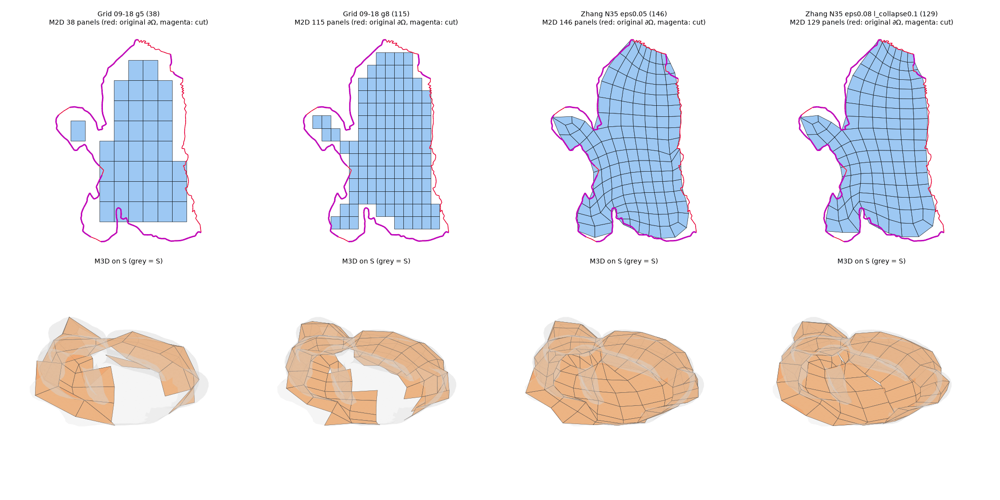
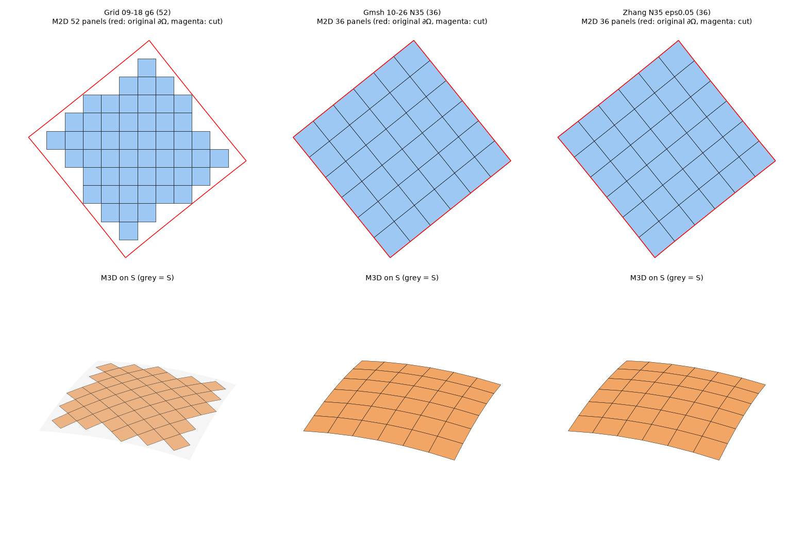
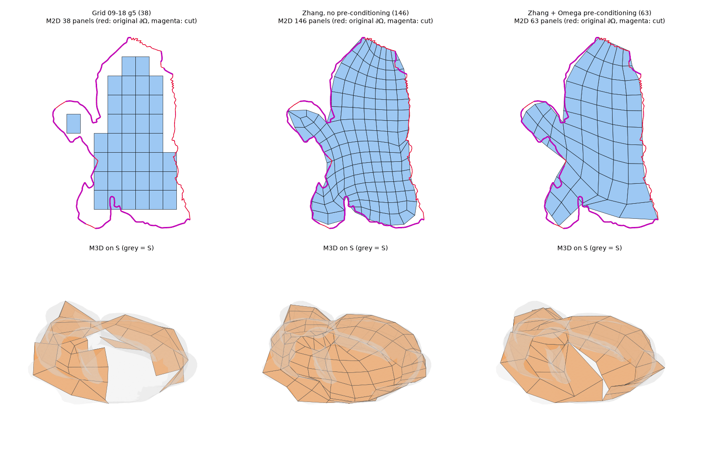

# 2026-10-27 Zhang et al. (2021) M2D モード — 比較結果

本書は `docs/optcuts_zhang2021_quad_20261027_ja.md`（実装の説明）の結果編です。
数値はすべてこのリポジトリのコードを実際に実行して得たもので、表は計測スクリプトの出力から生成しています（手入力なし）。

## 0. 要約

> **追補（§8）**: Quad Meshing の前に Ω の境界を単純化する前処理（2026-10-26 設計の Step 2）を加えた結果、Bunny でも **63 枚・奇数価数の内部頂点 0・09-18 ルートで T2D 成功（衝突 0）・Split 既定値で通過**となりました。以下の §0〜§7 は前処理なしの結果です。

* **論文の処理は著者の参照実装そのものを実行しています。** Straighten / Segment / QMSim を著者の `WholePipeline.bat` と同じ引数で実行し、
  移植ビルドは原版の Windows 実行ファイル（Wine）と 5 サンプルで比較済みです（原版自身の数値感度の範囲で一致）。M2D は論文の出力 Q を変更せずに使います
  （`zhang2021_m2d_is_unmodified_paper_output`）。Gmsh や切り抜き格子への置き換え・フォールバックはありません。
* **目標 30 / 35 枚は、単純な領域ではほぼ実現しますが、Bunny 由来 Ω では実現しません。**
  単純領域（ε = 0.05）では 27〜48 枚。Bunny（代替メッシュ）の OptCuts Ω では、ε・N_tar・l_collapse をどう変えても
  実パネル数は **117 枚以上**（アプリでの実行は 129〜156 枚）でした。論文自身が「非常に小さい N_tar は Hausdorff 制約のため通常満たされない」と述べている挙動で、
  粗いレイアウトの段階で 21〜27 個のパッチに分かれることが下限を決めています。実数と目標値は常に別々に表示します（`zhang2021_requested_vs_actual_quads`）。
* **Ω の被覆: Zhang の M3D は S の 100% を隙間・はみ出しなく覆います**（従来 Grid は 58〜77%、境界 Hausdorff 5.9〜21.9% bbox、孤立パネルあり）。
  これは論文ではなく OneString 拡張（チャートを Q の境界多角形へ全単射に再パラメータ化）によるもので、代償としてチャートの歪みが増えます（SD 平均 4.10→4.30〜4.44）。
* **Seam は Bunny では soft（近似閉合）にとどまります。** カット先端が 2 枚の四角形にしか属さず、頂点数をそろえて hard にすると先端パネルが潰れるため、
  poly-chord 挿入は採用されませんでした（明示的に理由を記録）。K3D 後の Seam 残差は最大 0.08〜0.16（パネル辺長 約 0.17〜0.18）です。
* **下流は Bunny で通りません。** 既存の optcuts_test2 ルートでは K3D 後に 15° 未満の四角形が 2〜5 枚でき（最小 1.8〜10.7°）、T2D は衝突が残りました。
  従来 Grid と同じ 09-18 ルートを選ぶと、Bunny の Zhang レイアウトに含まれる価数 3/5 の特異頂点のため Sec. 4.3 の交互連結が作れず、
  `ZHANG2021_PAPER_LG_LINKAGE_NON_BIPARTITE` で明示的に停止します（Bunny の全設定で奇数価数の内部頂点が 1〜4 個）。
* **ドームでは成功しますが、Bunny での成功を意味しません。** 同じ曲面・同じ 09-18 ルートで比較すると、Zhang（1 パッチ、36 枚、被覆 100%）も
  T2D まで衝突 0 で通ります。optcuts_test2 ルートではドームでも T2D に衝突が残りますが、これは M2D ではなく下流ルート（従来 Dual Hinge）の差です（Gmsh 版も同じ）。
* **現在の実験方式（Gmsh 10-26）は Bunny（代替）で M3D 品質検査により、面積格子（10-23）は境界の位相検査により停止しました。**

## 1. 実験条件

* 実行環境: Linux x86-64（クラウドの検証環境）、Python 3.13、GCC ビルドの Zhang 参照プログラム（`scripts/setup_zhang2021_quad_official.py`）、
  公式 OptCuts。Mac（Apple Silicon、Clang）では Zhang の結果が変わり得ます（§6.7）。
* 入力形状
  * **Bunny**: ユーザーの `Remeshed_Bunny.stl` はこの環境に無く（Mac の Downloads へのアクセスも許可されなかったため）、代替メッシュを使いました。
    common-3d-test-models の閉じた `stanford-bunny.obj` を `tools/remesh_closed_bunny.py`（Botsch–Kobbelt 再メッシュ）で粗くし、
    底面の面を削除して単一境界の円板にしたもの（`docs/closed_bunny_remesh_mac_windows_ja.md` の手順に倣ったもの。2,848 頂点、5,607 三角形）を
    `~/Downloads/Remeshed_Bunny.stl` に置き、アプリの既定ターゲットとして読み込ませています。
    **数値はこの代替メッシュでのものです。** 閉じた種数 0 のメッシュでは OptCuts のカットやマルチスタートの有無が変わるため、
    ユーザーの実データでは結果が変わり得ます。
  * **ドーム**: アプリ内蔵の `dome`（開いた円板、カット不要）。
  * **単純な平面領域**: 長方形・L 字・円板・円環（Zhang の参照プログラム単体）。
* 実行方法: 実アプリ `app_optcuts_20260923_extrusion_aware.py` を Streamlit AppTest でヘッドレス実行（UI と同じ経路・同じパラメータ受け渡し）。
  「Paper-oriented computation mode」OFF、Omega parameterization mode で各方式を選択。それ以外は既定値。
* 比較した方式

| 呼称 | Omega parameterization mode | M2D | 下流（K3D/K2D/T2D） |
|---|---|---|---|
| 従来方式 | `optcuts_paper_local_global_k3d_k2d`（2026-09-18） | 正方格子 + 切り抜き（grid size = 一辺のタイル数） | Eq.(1)/(5) local/global、Sec. 4.3 連結、論文 Dual Hinge |
| 現在の実験方式 | `optcuts_planar_quad_20261026` | Gmsh | optcuts_test2 |
| 参考 | 2026-10-23 Area-Threshold Grid Boundary | 面積しきい値付き格子 | optcuts_test2 |
| 新方式 | `optcuts_zhang2021_quad_20261027` | Zhang 2021（著者コード）+ OneString アダプタ | `optcuts_test2`（既定）または `paper_local_global_0918` |

* 統一指標（全方式で同じ式。`compare_metrics.py`）
  * 実パネル数 = M2D の四角形数（目標値ではなく実測値）
  * S 被覆率 = 最終チャート上の S の三角形のうち、重心が M2D パネル内に入るものの 3D 面積比
  * Ω外 = M2D パネル和集合のうちチャート外にある面積比
  * 境界 Hausdorff = M2D 境界と**元の** OptCuts ∂Ω の両側 Hausdorff 距離 / Ω の bbox 対角
  * 角度・辺長比・面積 CV（変動係数）・平面性（四角形の 4 隅から最小二乗平面までの最大距離 / 平均辺長）
  * チャート SD = 対称ディリクレエネルギーの面積加重平均（等長で 4）
  * Seam 残差 = OptCuts Seam の対応行（affine rows）の 3D 残差の最大値
  * T2D: Sec. 4.3 連結の有無、最終衝突数、ヒンジ誤差 rms

## 2. 単純な平面領域（Zhang 参照プログラム単体）

論文既定（N_tar = 4000, ε = 0.01）と、目標 30 / 35 枚での結果です（各領域の Ω は 2D 三角形メッシュ、l_collapse は既定 0.05）。

| 領域 | N_tar | ε | 実 quads | パッチ数 | J_min | J_avg | d_H %bbox | 秒 |
|---|---|---|---|---|---|---|---|---|
| 長方形 2:1 | 4000（論文既定） | 0.01 | 4005 | 1 | 1.000 | 1.000 | 0.000 | 11.5 |
| 長方形 2:1 | 30 | 0.01 | 276 | 1 | 1.000 | 1.000 | 0.000 | 1.0 |
| 長方形 2:1 | 30 | 0.05 | 32 | 1 | 1.000 | 1.000 | 0.000 | 0.4 |
| 長方形 2:1 | 35 | 0.01 | 276 | 1 | 1.000 | 1.000 | 0.000 | 1.1 |
| 長方形 2:1 | 35 | 0.05 | 32 | 1 | 1.000 | 1.000 | 0.000 | 0.4 |
| L 字 | 4000（論文既定） | 0.01 | 4107 | 3 | 1.000 | 1.000 | 0.000 | 6.2 |
| L 字 | 30 | 0.01 | 261 | 3 | 0.956 | 0.999 | 0.000 | 1.4 |
| L 字 | 30 | 0.05 | 27 | 3 | 1.000 | 1.000 | 0.000 | 0.9 |
| L 字 | 35 | 0.01 | 261 | 3 | 0.956 | 0.999 | 0.000 | 1.5 |
| L 字 | 35 | 0.05 | 27 | 3 | 1.000 | 1.000 | 0.000 | 0.9 |
| 円板 | 4000（論文既定） | 0.01 | 4480 | 5 | 0.845 | 0.996 | 0.023 | 13.0 |
| 円板 | 30 | 0.01 | 255 | 5 | 0.850 | 0.981 | 0.535 | 1.9 |
| 円板 | 30 | 0.05 | 40 | 5 | 0.857 | 0.942 | 2.498 | 1.0 |
| 円板 | 35 | 0.01 | 255 | 5 | 0.850 | 0.981 | 0.535 | 1.9 |
| 円板 | 35 | 0.05 | 48 | 5 | 0.858 | 0.949 | 1.269 | 1.0 |
| 円環（穴あり） | 4000（論文既定） | 0.01 | 4446 | 1 | 0.781 | 0.998 | 0.032 | 10.7 |
| 円環（穴あり） | 30 | 0.01 | 336 | 1 | 0.925 | 0.994 | 0.487 | 2.1 |
| 円環（穴あり） | 30 | 0.05 | 30 | 1 | 0.959 | 0.972 | 2.363 | 1.4 |
| 円環（穴あり） | 35 | 0.01 | 336 | 1 | 0.925 | 0.994 | 0.487 | 2.2 |
| 円環（穴あり） | 35 | 0.05 | 30 | 1 | 0.959 | 0.972 | 2.363 | 1.5 |

* 長方形・L 字では目標近くの枚数（32、27）になり、J_min = 1（全て正方形）です。円板は 5 パッチに分かれるため 40〜48 枚、
  円環は 1 パッチで 30 枚でした。
* 論文既定の ε = 0.01 では、N_tar = 30 / 35 を指定しても 255〜336 枚になります（Hausdorff 上限が優先）。
* N_tar = 30 と 35 で結果が同じ領域が多く、N_tar は細かな枚数の指定には使えません。

## 3. Bunny 由来 Ω での Zhang 単体（ε の掃引）

アプリが Zhang に渡した OptCuts チャート（E2E と同じ入力）に対して参照プログラムだけを実行した結果です。

| ε（× bbox 対角） | N_tar | 実 quads | パッチ数 | J_min | J_avg | d_H %bbox | 奇数価数の内部頂点 | 秒 |
|---|---|---|---|---|---|---|---|---|
| 0.01 | 30 | 5089 | 77 | 0.332 | 0.977 | 0.54 | 1 | 43.0 |
| 0.01 | 35 | 5089 | 77 | 0.332 | 0.977 | 0.54 | 1 | 43.3 |
| 0.02 | 30 | 588 | 16 | 0.592 | 0.974 | 1.22 | 1 | 14.4 |
| 0.02 | 35 | 588 | 16 | 0.592 | 0.974 | 1.22 | 1 | 14.7 |
| 0.03 | 30 | 321 | 33 | 0.444 | 0.950 | 2.76 | 4 | 12.9 |
| 0.03 | 35 | 500 | 33 | 0.438 | 0.948 | 2.79 | 4 | 14.0 |
| 0.05 | 30 | 152 | 27 | 0.339 | 0.918 | 4.72 | 2 | 10.2 |
| 0.05 | 35 | 146 | 26 | 0.438 | 0.917 | 4.40 | 3 | 11.5 |
| 0.08 | 30 | 154 | 27 | 0.356 | 0.921 | 5.03 | 2 | 9.1 |
| 0.08 | 35 | 156 | 25 | 0.403 | 0.934 | 4.54 | 3 | 11.7 |
| 0.12 | 30 | 154 | 27 | 0.356 | 0.921 | 5.03 | 2 | 9.1 |
| 0.12 | 35 | 156 | 25 | 0.403 | 0.934 | 4.54 | 3 | 11.2 |

論文のパラメータ l_collapse（poly-chord collapse の幅の上限）を大きくした場合:

| ε | l_collapse（× bbox 対角、論文既定 0.05） | N_tar | 実 quads | パッチ数 | J_min | d_H %bbox | 奇数価数の内部頂点 |
|---|---|---|---|---|---|---|---|
| 0.05 | 0.1 | 30 | 140 | 21 | 0.376 | 4.59 | 2 |
| 0.05 | 0.1 | 35 | 117 | 22 | 0.403 | 4.47 | 3 |
| 0.05 | 0.2 | 30 | 140 | 21 | 0.376 | 4.59 | 2 |
| 0.05 | 0.2 | 35 | 117 | 22 | 0.403 | 4.47 | 3 |
| 0.05 | 0.3 | 30 | 140 | 21 | 0.376 | 4.59 | 2 |
| 0.05 | 0.3 | 35 | 117 | 22 | 0.403 | 4.47 | 3 |
| 0.08 | 0.1 | 30 | 140 | 21 | 0.363 | 4.99 | 2 |
| 0.08 | 0.1 | 35 | 129 | 22 | 0.412 | 5.24 | 3 |
| 0.08 | 0.2 | 30 | 140 | 21 | 0.363 | 4.99 | 2 |
| 0.08 | 0.2 | 35 | 129 | 22 | 0.412 | 5.24 | 3 |
| 0.08 | 0.3 | 30 | 140 | 21 | 0.363 | 4.99 | 2 |
| 0.08 | 0.3 | 35 | 129 | 22 | 0.412 | 5.24 | 3 |

* どの設定でも 117 枚未満にはなりません。ε を 0.08 以上にしても結果は変わらず（Hausdorff 以外の制約で collapse が止まる）、
  l_collapse は 0.1 以上で頭打ちです。
* 論文既定の ε = 0.01 では 5,089 枚です。
* 奇数価数の内部頂点（§6.4）はすべての設定で 1〜4 個あります。

## 4. E2E 比較: Bunny（代替メッシュ）



上段: Ω 上の M2D（赤 = 元の OptCuts ∂Ω、紫 = カット）。Zhang の M2D は再パラメータ化後のチャート座標で描いているため、
元の ∂Ω からのずれ（≦ ε）がそのまま境界近似誤差です。下段: S（灰色）上の M3D。

| 方式 | 結果 | 実パネル数 | M2D 境界ループ | S 被覆率 % | Ω外 % | 境界 Hausdorff %bbox | チャート SD 平均（元→最終） | 面積比 p99/p1（元→最終） | 時間 s |
|---|---|---|---|---|---|---|---|---|---|
| Grid 09-18 g4 | 成功 | 22 | 1 | 58.4 | 0.41 | 21.89 | 4.099 | 2.06 | 54 |
| Grid 09-18 g5 | 成功 | 38 | 2 | 64.5 | 1.16 | 8.90 | 4.099 | 2.06 | 63 |
| Grid 09-18 g6 | 成功 | 55 | 2 | 65.3 | 6.9e-03 | 7.25 | 4.099 | 2.06 | 113 |
| Grid 09-18 g7 | 成功 | 83 | 3 | 72.4 | 4.2e-05 | 6.67 | 4.099 | 2.06 | 120 |
| Grid 09-18 g8 | 成功 | 115 | 2 | 76.6 | 0.12 | 5.85 | 4.099 | 2.06 | 142 |
| 面積格子 10-23 g6 | 失敗: GRID_SEAM_ALL_GRID_ORIENTATION_CANDIDATES_FAILED | – | – | – | – | – | – | – | 57 |
| 面積格子 10-23 g8 | 失敗: GRID_SEAM_ALL_GRID_ORIENTATION_CANDIDATES_FAILED | – | – | – | – | – | – | – | 72 |
| Gmsh 10-26 N35 | 失敗: PLANAR_QUAD_3D_REFINEMENT_REGRESSED | – | – | – | – | – | – | – | 37 |
| Gmsh 10-26 N35 refine off | 失敗: PLANAR_QUAD_PANEL_QUALITY_INVALID | – | – | – | – | – | – | – | 37 |
| Gmsh 10-26 N30 refine off | 失敗: PLANAR_QUAD_PANEL_QUALITY_INVALID | – | – | – | – | – | – | – | 33 |
| Zhang N35 ε.05 Split既定 | 失敗: ZHANG2021_CSF_SPLIT_UNCERTIFIED | – | – | – | – | – | – | – | 46 |
| Zhang N35 ε.05 | 成功 | 146 | 1 | 100.0 | 0.00 | 4.40 | 4.099→4.415 | 2.06→3.18 | 314 |
| Zhang N30 ε.05 | 成功 | 152 | 1 | 100.0 | 0.00 | 4.72 | 4.099→4.296 | 2.06→3.06 | 289 |
| Zhang N35 ε.08 | 成功 | 156 | 1 | 100.0 | 0.00 | 4.54 | 4.099→4.336 | 2.06→2.99 | 326 |
| Zhang N30 ε.08 | 成功 | 154 | 1 | 100.0 | 0.00 | 5.03 | 4.099→4.304 | 2.06→3.30 | 315 |
| Zhang N35 ε.08 l_collapse.1 | 成功 | 129 | 1 | 100.0 | 0.00 | 5.24 | 4.099→4.443 | 2.06→3.11 | 285 |
| Zhang N35 ε.05 09-18ルート | 失敗: ZHANG2021_PAPER_LG_LINKAGE_NON_BIPARTITE | – | – | – | – | – | – | – | 56 |
| Zhang N35 ε.08 09-18ルート | 失敗: ZHANG2021_PAPER_LG_LINKAGE_NON_BIPARTITE | – | – | – | – | – | – | – | 56 |

| 方式 | M2D 最小角° | M2D 辺長比 max | M2D 面積 CV | M3D 最小角° | M3D 辺長比 max | M3D 面積 CV | M3D 最小角<30° の割合 % |
|---|---|---|---|---|---|---|---|
| Grid 09-18 g4 | 90.0 | 1.39 | 5.6e-16 | 59.6 | 1.73 | 0.117 | 0.0 |
| Grid 09-18 g5 | 90.0 | 1.39 | 6.6e-16 | 18.7 | 4.19 | 0.181 | 2.6 |
| Grid 09-18 g6 | 90.0 | 1.39 | 7.1e-16 | 48.3 | 2.35 | 0.150 | 0.0 |
| Grid 09-18 g7 | 90.0 | 1.39 | 8.1e-16 | 23.6 | 2.17 | 0.153 | 1.2 |
| Grid 09-18 g8 | 90.0 | 1.39 | 1.0e-15 | 46.1 | 2.85 | 0.141 | 0.0 |
| 面積格子 10-23 g6 | – | – | – | – | – | – | – |
| 面積格子 10-23 g8 | – | – | – | – | – | – | – |
| Gmsh 10-26 N35 | – | – | – | – | – | – | – |
| Gmsh 10-26 N35 refine off | – | – | – | – | – | – | – |
| Gmsh 10-26 N30 refine off | – | – | – | – | – | – | – |
| Zhang N35 ε.05 Split既定 | – | – | – | – | – | – | – |
| Zhang N35 ε.05 | 33.8 | 5.57 | 0.227 | 19.2 | 6.14 | 0.251 | 2.7 |
| Zhang N30 ε.05 | 28.2 | 7.53 | 0.269 | 26.0 | 12.48 | 0.300 | 4.6 |
| Zhang N35 ε.08 | 35.3 | 3.56 | 0.207 | 25.5 | 6.05 | 0.267 | 0.6 |
| Zhang N30 ε.08 | 26.0 | 8.82 | 0.273 | 25.5 | 12.48 | 0.322 | 3.2 |
| Zhang N35 ε.08 l_collapse.1 | 35.5 | 3.99 | 0.219 | 28.5 | 6.25 | 0.278 | 0.8 |
| Zhang N35 ε.05 09-18ルート | – | – | – | – | – | – | – |
| Zhang N35 ε.08 09-18ルート | – | – | – | – | – | – | – |

| 方式 | Seam | Seam 残差 max | K3D 平面性 max | K3D 最小角° | K3D 辺長比 max | T2D 連結(Sec.4.3) | T2D 衝突 | ヒンジ誤差 rms |
|---|---|---|---|---|---|---|---|---|
| Grid 09-18 g4 | – | – | 0.0174 | 55.0 | 1.68 | ✓ | 0 | 0.008 |
| Grid 09-18 g5 | – | – | 0.0427 | 55.8 | 1.88 | ✓ | 0 | 0.010 |
| Grid 09-18 g6 | – | – | 0.0645 | 55.4 | 1.72 | ✓ | 0 | 0.009 |
| Grid 09-18 g7 | – | – | 0.0387 | 43.6 | 18.98 | ✓ | 0 | 0.011 |
| Grid 09-18 g8 | – | – | 0.0457 | 44.1 | 11.15 | ✓ | 0 | 0.009 |
| 面積格子 10-23 g6 | – | – | – | – | – | – | – | – |
| 面積格子 10-23 g8 | – | – | – | – | – | – | – | – |
| Gmsh 10-26 N35 | – | – | – | – | – | – | – | – |
| Gmsh 10-26 N35 refine off | – | – | – | – | – | – | – | – |
| Gmsh 10-26 N30 refine off | – | – | – | – | – | – | – | – |
| Zhang N35 ε.05 Split既定 | – | – | – | – | – | – | – | – |
| Zhang N35 ε.05 | soft | 0.080 | 0.1460 | 3.3 | 269.11 | ✗ | 287 | 0.167 |
| Zhang N30 ε.05 | soft | 0.115 | 0.0872 | 2.1 | 38.35 | ✗ | 390 | 0.163 |
| Zhang N35 ε.08 | soft | 0.118 | 0.0927 | 10.7 | 19.26 | ✗ | 360 | 0.167 |
| Zhang N30 ε.08 | soft | 0.106 | 0.0891 | 1.8 | 16.23 | ✗ | 302 | 0.164 |
| Zhang N35 ε.08 l_collapse.1 | soft | 0.164 | 0.1199 | 9.5 | 20.20 | ✗ | 247 | 0.177 |
| Zhang N35 ε.05 09-18ルート | – | – | – | – | – | – | – | – |
| Zhang N35 ε.08 09-18ルート | – | – | – | – | – | – | – | – |

09-18 ルート（従来 Grid と同じ下流）の K3D は K2D で停止する前に計算されるので、診断用に保存して同じ式で評価しました:

| 方式 | K3D 最小角° | K3D 最大角° | K3D 辺長比 max | K3D 平面性 max | Seam 残差 max / rms（閉合しない） | K2D |
|---|---|---|---|---|---|---|
| Zhang N35 ε.05 09-18ルート | 4.9 | 176.8 | 5.75 | 0.0682 | 0.237 / 0.080 | 停止: NON_BIPARTITE（奇数価数の内部頂点 3 個） |
| Zhang N35 ε.08 09-18ルート | 13.2 | 174.6 | 5.31 | 0.0712 | 0.167 / 0.066 | 停止: NON_BIPARTITE（奇数価数の内部頂点 3 個） |

* Bunny の Zhang は Split 既定値（上限 2）では `ZHANG2021_CSF_SPLIT_UNCERTIFIED` で停止します（§6.5）。それ以外の Zhang の行は Split しきい値 1000 です。
* 従来 Grid の行の Seam 欄が「–」なのは、09-18 ルートが OptCuts の Seam を扱わないためです（カットの両側のパネルは独立に切り抜かれ、閉合も計測もされません）。
  M2D 境界ループが 2〜3 本の行は、辺でつながっていないパネル群に分かれていることを示します（g5〜g8 で 2〜3 群。図の g5 の耳の 1 枚など。g8 の 2 群は 1 頂点でのみ接する）。
* Zhang の実行時間の内訳（ε = 0.05, N_tar = 35、計 314 s）: OptCuts 24.5 s、Zhang 段 13.8 s（Straighten 0.8 + Segment 9.7 + QMSim 0.8 +
  OneString の再パラメータ化 2.2 + 入出力）。残りの約 276 s は既存の K3D / T3D / K2D / T2D です（従来 Grid の全体は 54〜142 s）。

## 5. E2E 比較: ドーム

内蔵の `dome` は grid size から生成されるため（§7）、**全方式を同じ曲面で比べるドーム A（grid size = 6）**を主な比較とします。



**ドーム A**（S = 0.6 × 0.6 × 0.06、全方式で同一）:

| 方式 | 結果 | 実パネル数 | M2D 境界ループ | S 被覆率 % | Ω外 % | 境界 Hausdorff %bbox | チャート SD 平均（元→最終） | 面積比 p99/p1（元→最終） | 時間 s |
|---|---|---|---|---|---|---|---|---|---|
| Grid 09-18 g6 | 成功 | 52 | 1 | 72.7 | 0.00 | 7.53 | 4.000 | 1.01 | 32 |
| Gmsh 10-26 N35 | 成功 | 36 | 1 | 100.0 | 0.00 | 6.5e-15 | 4.000 | 1.01 | 44 |
| Zhang N35 ε.05 test2ルート | 成功 | 36 | 1 | 100.0 | 1.8e-15 | 0.01 | 4.000→4.000 | 1.01→1.01 | 50 |
| Zhang N35 ε.05 09-18ルート | 成功 | 36 | 1 | 100.0 | 1.8e-15 | 0.01 | 4.000→4.000 | 1.01→1.01 | 54 |

| 方式 | M2D 最小角° | M2D 辺長比 max | M2D 面積 CV | M3D 最小角° | M3D 辺長比 max | M3D 面積 CV | M3D 最小角<30° の割合 % |
|---|---|---|---|---|---|---|---|
| Grid 09-18 g6 | 90.0 | 1.00 | 5.9e-16 | 89.6 | 1.00 | 0.002 | 0.0 |
| Gmsh 10-26 N35 | 89.7 | 1.01 | 0.003 | 88.5 | 1.01 | 0.004 | 0.0 |
| Zhang N35 ε.05 test2ルート | 88.5 | 1.01 | 0.001 | 88.5 | 1.01 | 0.004 | 0.0 |
| Zhang N35 ε.05 09-18ルート | 88.5 | 1.01 | 0.001 | 88.5 | 1.01 | 0.004 | 0.0 |

| 方式 | Seam | Seam 残差 max | K3D 平面性 max | K3D 最小角° | K3D 辺長比 max | T2D 連結(Sec.4.3) | T2D 衝突 | ヒンジ誤差 rms |
|---|---|---|---|---|---|---|---|---|
| Grid 09-18 g6 | – | – | 1.7e-05 | 89.0 | 1.02 | ✓ | 0 | 1.3e-06 |
| Gmsh 10-26 N35 | – | – | 7.7e-05 | 89.7 | 1.01 | ✗ | 35 | 0.032 |
| Zhang N35 ε.05 test2ルート | – | – | 7.5e-05 | 89.7 | 1.01 | ✗ | 31 | 0.038 |
| Zhang N35 ε.05 09-18ルート | none (paper_local_global_0918 route) | – | 9.7e-07 | 88.9 | 1.01 | ✓ | 0 | 8.2e-07 |

**ドーム B**（既定の grid size = 20、S = 2.0 × 2.0 × 0.667。切り抜き格子は同じ曲面で 35 枚前後にできないため Gmsh と Zhang のみ）:

| 方式 | 結果 | 実パネル数 | M2D 境界ループ | S 被覆率 % | Ω外 % | 境界 Hausdorff %bbox | チャート SD 平均（元→最終） | 面積比 p99/p1（元→最終） | 時間 s |
|---|---|---|---|---|---|---|---|---|---|
| Gmsh 10-26 N35 | 成功 | 36 | 1 | 100.0 | 0.00 | 7.1e-15 | 4.034 | 1.11 | 69 |
| Zhang N35 ε.05 test2ルート | 成功 | 36 | 1 | 100.0 | 0.00 | 0.10 | 4.004→4.004 | 1.14→1.14 | 68 |
| Zhang N35 ε.05 09-18ルート | 成功 | 36 | 1 | 100.0 | 0.00 | 0.10 | 4.004→4.004 | 1.14→1.14 | 62 |

| 方式 | M2D 最小角° | M2D 辺長比 max | M2D 面積 CV | M3D 最小角° | M3D 辺長比 max | M3D 面積 CV | M3D 最小角<30° の割合 % |
|---|---|---|---|---|---|---|---|
| Gmsh 10-26 N35 | 89.7 | 1.00 | 0.002 | 76.2 | 1.08 | 0.025 | 0.0 |
| Zhang N35 ε.05 test2ルート | 77.0 | 1.08 | 0.010 | 76.3 | 1.06 | 0.029 | 0.0 |
| Zhang N35 ε.05 09-18ルート | 77.0 | 1.08 | 0.010 | 76.3 | 1.06 | 0.029 | 0.0 |

| 方式 | Seam | Seam 残差 max | K3D 平面性 max | K3D 最小角° | K3D 辺長比 max | T2D 連結(Sec.4.3) | T2D 衝突 | ヒンジ誤差 rms |
|---|---|---|---|---|---|---|---|---|
| Gmsh 10-26 N35 | – | – | 0.0012 | 83.6 | 1.11 | ✗ | 25 | 0.528 |
| Zhang N35 ε.05 test2ルート | – | – | 0.0014 | 83.8 | 1.09 | ✗ | 38 | 0.497 |
| Zhang N35 ε.05 09-18ルート | none (paper_local_global_0918 route) | – | 0.0001 | 80.2 | 1.05 | ✓ | 0 | 2.9e-04 |

* ドームでは Zhang は 1 パッチ（6 × 6 の構造格子、全内部頂点の価数 4）で、N_tar = 35 に対し 36 枚です。
* 同じ 09-18 ルートなら、Zhang の M2D も従来 Grid と同様に T2D まで衝突 0 で通ります（Sec. 4.3 連結 ✓）。
* optcuts_test2 ルートの T2D 衝突（25〜38）は Gmsh 版と Zhang で同程度で、M2D ではなく下流ルートの性質です。
* ドームでの成功は、カット・特異頂点・大きな面積歪みが無い場合の結果であり、Bunny での成功を意味しません（§4）。

## 6. 判明した問題と考察

### 6.1 パネル数: 30 / 35 枚は Bunny（代替）Ω では得られない

* Zhang の N_tar が決めるのは目標辺長 l_tar = sqrt(面積/N_tar) だけで、Hausdorff 上限 ε と境界特徴点の保存が優先されます。
  論文本文にも「非常に大きい l_tar（非常に小さい N_tar）は Hausdorff 制約のため通常満たされない」とあります。
* 単純領域では ε = 0.05 で N_tar = 30/35 に対し 27〜48 枚（長方形 32、L 字 27、円板 40/48、円環 30）。論文既定の ε = 0.01 では 255〜336 枚です。
* Bunny の OptCuts Ω（アプリが Zhang に渡したチャートそのもの）では、
  ε ≥ 0.05 で 146〜156 枚、論文パラメータ l_collapse を 0.1 以上にしても 117〜140 枚で頭打ちでした（§3）。
  粗いレイアウトの段階で 21〜27 個のパッチに分かれ、各パッチを形の良い四角形で埋める必要があるためです。
* N_tar と実数は単調な関係になく（例: ε = 0.05, l_collapse = 0.1 で N_tar = 30 → 140 枚、35 → 117 枚）、
  参照実装は入力の微小な差にも敏感です（§6.7）。UI とメトリクスでは要求値と実数を必ず別々に示し、
  `zhang2021_target_reached` が False のまま「達成」とは表示しません。
* 30〜35 枚に近づけるには、論文の範囲外の処理（例: Ω の境界を単純化してから Zhang に渡す、OptCuts のカットを変える）が必要です。
  これは原論文の処理と混同しないよう、今回は実装していません。

### 6.2 Ω の被覆と境界近似

* 従来 Grid は格子セルを Ω で切り抜くため、S の 58〜77% しか覆わず、境界付近に大きな欠けが残ります（g5 では耳の部分に孤立した 1 枚のパネルができ、M2D の境界ループが 2 本）。
* Zhang の Q は ∂Ω から最大 ε（ε = 0.05 で実測 4.4〜5.0% bbox）離れます。OneString 拡張で Ω 自体を Q の境界多角形に一致するよう全単射に再パラメータ化するので、
  最終的な M3D は S を 100% 覆い、はみ出しもありません。代償はチャートの歪みです。平均はわずか（SD 平均 4.10 → 4.30〜4.44、p95 4.29 → 5.0〜5.5）ですが、
  境界の近くに集中して局所的に大きく（SD 上位 1% の三角形の境界からの距離の中央値は bbox 対角の 0.4%、全体では 5.9%）、SD の最大値は 10.5 → 35〜72、三角形の面積比の max/min は 4.75 → 29〜49 になりました。
  この歪みは M3D パネルの形と CSF（面積伸長）に効きます（§6.5）。ε を小さくすればこの歪みは減りますが、パネル数が増えます（§3）。
* Gmsh 10-26 はドームでは境界誤差 0（Ω をそのまま四角形分割）ですが、Bunny（代替）では M3D 品質検査で停止しました。

### 6.3 OptCuts Seam との整合（OneString 拡張 ③）

* Zhang の Q はカットの両側を独立に近似するので、両側の分割点数は一般に一致しません。OneString 拡張では
  (a) カット先端・分岐・カット/開境界の切替点を必ず Q の頂点にし、(b) 全境界頂点をカット上に置き、
  (c) 両側の頂点数が一致したカット枝は 3D 位置をそろえて hard、そうでない枝は soft（既存の affine 行で近似閉合）にしています。
* 頂点数をそろえる poly-chord 挿入（任意機能）は、Bunny では一度も採用されませんでした。全カットの数を合わせることはできても、
  カット先端の頂点が 2 枚の四角形にしか属さず、hard 閉合すると先端のパネルが 3D で約 180° に開くか潰れるためです
  （`cut tip carried by fewer than 3 quads` として記録し、論文の Q のまま soft で続行）。l_collapse = 0.1 の 1 例では、上限の挿入数内で全カットの数をそろえられず（`unbalanced`）不採用でした。
* その結果、Bunny では hard/soft のカット枝が 1〜4 / 2〜5 本混在し、K3D 後の Seam 残差は最大 0.08〜0.16（パネルの辺長 約 0.17〜0.18 に対し無視できない大きさ）でした。
  09-18 ルート（Seam を閉じない）では残差 0.17〜0.24 がそのまま残ります。
* ドームは開いた円板でカットが無いため、この問題は現れません。

### 6.4 Sec. 4.3 の交互コーナー連結と特異頂点（下流の互換性）

* 従来 Grid の T2D が通るのは、09-18 ルートの K2D が四角形を 2 色に塗り分けて「交互にコーナーで連結」する（回転正方形型オーゼティック）からです。
  これは四角形の隣接グラフが二部グラフ、すなわち全内部頂点の価数が偶数であることを要します。切り抜き格子は常にこれを満たします。
* Zhang の粗いレイアウトはパッチ分割線が交わる点などに特異頂点（価数 3 や 5）を含みます（Bunny で E2E に使ったメッシュの奇数価数の内部頂点はすべて価数 3）。Bunny では調べた全設定（ε 0.01〜0.12、l_collapse 0.05〜0.3、N_tar 30/35）で
  奇数価数の内部頂点が 1〜4 個あり、交互連結は構成できません。09-18 ルートを選ぶと K3D までは計算され、K2D で
  `ZHANG2021_PAPER_LG_LINKAGE_NON_BIPARTITE` により停止します（他ルートへの自動切替はしません）。
* ドーム（1 パッチ、内部頂点はすべて価数 4）では 09-18 ルートで T2D まで衝突 0 で成功しました。
* 特異頂点を含むメッシュに対応するには、下流側で（例えば奇数価数の頂点どうし・境界へ切れ目を入れて連結を局所的に外す）特異点処理が必要です。
  これは Zhang の論文にも既存 OneString にも無い処理で、今回は実装していません。

### 6.5 CSF Split

* 既存の CSF Split（面積伸長 2 以下に分割）は、格子の行・列に沿った直線で M2D を完全に切る方式です。非構造の Zhang メッシュではそのような切断線がほぼ無く、
  Bunny の Zhang チャートは λ_max = 2.54〜3.23 で上限 2 を超えるため、Split を認証できず `ZHANG2021_CSF_SPLIT_UNCERTIFIED` で停止します。
* 従来 Grid の λ_max は 1.24〜1.27 ですが、これは切り抜いた 58〜77% の領域だけでの値です。元の OptCuts チャート全体では三角形の面積比の max/min が既に 4.75 あり
  （境界付近ほど大きい）、Zhang の再パラメータ化はそれをさらに広げます（§6.2）。Bunny の Zhang の E2E は Split しきい値 1000（実質 OFF）で評価しました。
  ドームは λ_max = 1.03 で既定値のまま通ります。

### 6.6 K3D の縮退と T2D

* optcuts_test2 ルートの AL K3D では、M3D で最小角 19〜26° だった Zhang メッシュが、K3D 後に 15° 未満の四角形を 2〜5 枚含みました（最小 1.8〜10.7°、辺長比 最大 16〜269）。
  縮退はカット沿いと内部の両方で起き、特異頂点の周りに限りません（M3D で既に 140° 前後の角を持つ四角形が潰れる）。
* 同じメッシュを 09-18 の local/global K3D に通しても最小角 4.9° / 13.2°、最大角 177° / 175° で、K3D ソルバーを替えても解消しません。
  M3D の段階の形状（パネルの角度・辺長の不揃い）が K3D の正方形化に対して厳しいことを示しています。
* test2 ルートの T2D（従来 Dual Hinge）は Bunny で衝突 247〜390、ドームでも衝突 25〜38 が残りました（Gmsh 版も同様）。この T2D は 8 秒の実時間予算で打ち切るため、
  衝突数は CPU 負荷で実行ごとに変わります（同じ入力で 36 と 38）。09-18 ルートの T2D（論文 Dual Hinge）は再実行で完全に一致しました。

### 6.7 プラットフォーム差と再現性

* 参照実装は数値的に非常に敏感で、原版の実行ファイル自身が入力の 1e-12 の摂動で 3380 → 6874 quads に変わります。
  コンパイラでも変わることがあり、単体で計算した OptCuts チャートでは GCC 206 / Clang(libc++) 144 quads、
  アプリが渡したチャートではどちらも 146 quads でした（ε = 0.05, N_tar = 35）。
  Mac（Apple Silicon）での数値は本書と一致しない可能性があり、本書の数値は Linux/GCC の 1 例です。

### 6.8 既存コードについて気付いた点（未変更）

* 2026-10-26 Gmsh 版の M2D フックは、外側の Simple Split と合わせて CSF Split を二重に評価します（ログで確認）。
  また閉じた種数 0 の入力で OptCuts のマルチスタート候補が付くと、Split 段で別チャートに差し替えられ M2D と M3D の対応が崩れ得ます。
  Zhang モードでは両方に対処しましたが、Gmsh 版は比較用に残す指示に従い変更していません。
* `tests/` の既存テストのうち 27 件の失敗と 4 件のエラーは、変更前の HEAD でも同一の集合で発生しています（今回の変更による回帰はありません）。

## 7. 再現手順

```bash
# 参照プログラムの取得・パッチ・ビルド（著者コードは同梱しない）
python3 scripts/setup_zhang2021_quad_official.py            # macOS: --cmake-arg=-DOpenMP_ROOT=$(brew --prefix libomp)
python3 -m pytest -q tests/test_zhang2021_quad_20261027.py   # 24 件（参照プログラム未ビルドなら 1 件 skip）
python3 -m streamlit run app_optcuts_20260923_extrusion_aware.py
```

UI での設定（Paper-oriented computation mode を OFF）:

| 本書の呼称 | Omega parameterization mode | 主な設定 |
|---|---|---|
| Grid 09-18 gN | `2026-09-18 \| OptCuts Ω + paper-aligned local/global K3D/K2D` | grid size = N |
| Gmsh 10-26 | `2026-10-26 \| OptCuts → boundary-conforming Planar Quad M2D (Gmsh prototype)` | 既定（N = 35） |
| Zhang | `2026-10-27 \| OptCuts → Zhang et al. 2021 Quad M2D (authors' reference code) + OneString seam/3D adapter` | N_tar、ε、l_collapse、下流ルート |
| Bunny の Zhang（Split OFF） | 同上 | 「Split threshold (Paper: conformal linear CSF; OFF: legacy)」= 1000 |
| ドーム A | 各モード | target shape = dome、grid size = 6（全方式で同じ曲面） |
| ドーム B | 各モード | target shape = dome、grid size = 20（既定） |

注意: 内蔵の `dome` などの解析曲面は `grid size`（と `tile size`）から生成されるため、grid size を変えると S 自体が変わります
（grid size 6 で 0.6 × 0.6 × 0.06、既定の 20 で 2.0 × 2.0 × 0.667）。方式を比べるときは全方式で同じ grid size にしてください。
本書のドーム A は全方式 grid size = 6 で比較しています。

計測は実アプリを Streamlit AppTest でヘッドレス実行し、M2D/M3D/K3D/チャートを保存して全方式に同じ式を適用しました
（統一指標は §1）。表はその出力から自動生成しています。

## 8. 追補: Ω の前処理を Zhang の前に入れた結果（2026-10-26 設計の Step 2〜6）

2026-10-26 の設計（φ₁ = h∘φ₀）どおり、**Quad Meshing の前に Ω を変形する段**を追加しました（既定で ON）。
処理順は `OptCuts → h（境界の単純化 + 全単射 SLIM）→ Zhang（Ω₁ を入力）→ OneString アダプタ → M2D/M3D 評価 → 候補選択` です。
実装の詳細は `docs/optcuts_zhang2021_quad_20261027_ja.md` の ⑤ を参照してください。

### 8.1 前処理だけを変えた Zhang 単体の結果（Bunny、アプリの OptCuts チャート）

前処理の SD 上限を外して（10 倍）、tol ごとの効果を見たものです。

| 前処理 tol | Zhang ε | N_tar | 実 quads | パッチ数 | J_min | 奇数価数の内部頂点 | 前処理後 SD 平均比 |
|---|---|---|---|---|---|---|---|
| 0.01 | 0.02 | 30 | 255 | 15 | 0.522 | 0 | 1.010 |
| 0.01 | 0.02 | 35 | 255 | 15 | 0.522 | 0 | 1.010 |
| 0.01 | 0.05 | 30 | 49 | 29 | 0.277 | 3 | 1.010 |
| 0.01 | 0.05 | 35 | 53 | 27 | 0.345 | 1 | 1.010 |
| 0.02 | 0.02 | 30 | 89 | 12 | 0.494 | 0 | 1.021 |
| 0.02 | 0.02 | 35 | 89 | 12 | 0.494 | 0 | 1.021 |
| 0.02 | 0.05 | 30 | 50 | 12 | 0.593 | 0 | 1.021 |
| 0.02 | 0.05 | 35 | 57 | 12 | 0.721 | 0 | 1.021 |
| 0.04 | 0.02 | 30 | 98 | 10 | 0.556 | 0 | 1.051 |
| 0.04 | 0.02 | 35 | 98 | 10 | 0.556 | 0 | 1.051 |
| 0.04 | 0.05 | 30 | 60 | 8 | 0.481 | 0 | 1.051 |
| 0.04 | 0.05 | 35 | 63 | 8 | 0.468 | 0 | 1.051 |
| 0.06 | 0.02 | 30 | 56 | 13 | 0.687 | 1 | 1.120 |
| 0.06 | 0.02 | 35 | 77 | 13 | 0.625 | 1 | 1.120 |
| 0.06 | 0.05 | 30 | 37 | 15 | 0.620 | 1 | 1.120 |
| 0.06 | 0.05 | 35 | 37 | 15 | 0.620 | 1 | 1.120 |
| 0.1 | 0.02 | 30 | 56 | 13 | 0.710 | 1 | 1.131 |
| 0.1 | 0.02 | 35 | 74 | 15 | 0.623 | 1 | 1.131 |
| 0.1 | 0.05 | 30 | 35 | 13 | 0.475 | 1 | 1.131 |
| 0.1 | 0.05 | 35 | 35 | 13 | 0.475 | 1 | 1.131 |

* 前処理なし（§3）では 117 枚未満にならず、奇数価数の内部頂点が必ず残りましたが、tol = 0.02〜0.04 では
  **50〜63 枚・奇数価数の内部頂点 0**（Sec. 4.3 の交互連結が可能）になりました。パッチ数も 26 → 8〜12 に減ります。
* tol ≥ 0.06 では **35〜37 枚**まで下がりますが、奇数価数の内部頂点が 1 個残り、前処理の SD 平均が 1.12〜1.13 倍になります（設計の上限 1.08 を超える）。

### 8.2 E2E（Bunny 代替メッシュ、既定の候補探索: tol ∈ {0, 0.02, 0.04, 0.06, 0.1} × ε ∈ {0.02, 0.05, 0.08}）



| 方式 | 結果 | 実パネル数 | M2D 境界ループ | S 被覆率 % | Ω外 % | 境界 Hausdorff %bbox | チャート SD 平均（元→最終） | 面積比 p99/p1（元→最終） | 時間 s |
|---|---|---|---|---|---|---|---|---|---|
| Grid 09-18 g5 | 成功 | 38 | 2 | 64.5 | 1.16 | 8.90 | 4.099 | 2.06 | 63 |
| Grid 09-18 g8 | 成功 | 115 | 2 | 76.6 | 0.12 | 5.85 | 4.099 | 2.06 | 142 |
| Zhang（前処理なし）test2 | 成功 | 146 | 1 | 100.0 | 0.00 | 4.40 | 4.099→4.415 | 2.06→3.18 | 314 |
| Zhang+前処理 09-18（Split既定） | 成功 | 63 | 1 | 100.0 | 0.00 | 4.11 | 4.099→4.468 | 2.06→3.26 | 196 |
| Zhang+前処理 09-18（Split OFF） | 成功 | 63 | 1 | 100.0 | 0.00 | 4.11 | 4.099→4.468 | 2.06→3.26 | 200 |
| Zhang+前処理 test2（Split OFF） | 成功 | 63 | 1 | 100.0 | 0.00 | 4.11 | 4.099→4.468 | 2.06→3.26 | 257 |

| 方式 | M2D 最小角° | M2D 辺長比 max | M2D 面積 CV | M3D 最小角° | M3D 辺長比 max | M3D 面積 CV | M3D 最小角<30° の割合 % |
|---|---|---|---|---|---|---|---|
| Grid 09-18 g5 | 90.0 | 1.39 | 6.6e-16 | 18.7 | 4.19 | 0.181 | 2.6 |
| Grid 09-18 g8 | 90.0 | 1.39 | 1.0e-15 | 46.1 | 2.85 | 0.141 | 0.0 |
| Zhang（前処理なし）test2 | 33.8 | 5.57 | 0.227 | 19.2 | 6.14 | 0.251 | 2.7 |
| Zhang+前処理 09-18（Split既定） | 31.6 | 9.29 | 0.316 | 22.6 | 8.38 | 0.403 | 3.2 |
| Zhang+前処理 09-18（Split OFF） | 31.6 | 9.29 | 0.316 | 22.6 | 8.38 | 0.403 | 3.2 |
| Zhang+前処理 test2（Split OFF） | 31.6 | 9.29 | 0.316 | 22.6 | 8.38 | 0.403 | 3.2 |

| 方式 | Seam | Seam 残差 max | K3D 平面性 max | K3D 最小角° | K3D 辺長比 max | T2D 連結(Sec.4.3) | T2D 衝突 | ヒンジ誤差 rms |
|---|---|---|---|---|---|---|---|---|
| Grid 09-18 g5 | – | – | 0.0427 | 55.8 | 1.88 | ✓ | 0 | 0.010 |
| Grid 09-18 g8 | – | – | 0.0457 | 44.1 | 11.15 | ✓ | 0 | 0.009 |
| Zhang（前処理なし）test2 | soft | 0.080 | 0.1460 | 3.3 | 269.11 | ✗ | 287 | 0.167 |
| Zhang+前処理 09-18（Split既定） | none (paper_local_global_0918 route) | 0.383 | 0.0324 | 8.6 | 14.15 | ✓ | 0 | 0.034 |
| Zhang+前処理 09-18（Split OFF） | none (paper_local_global_0918 route) | 0.383 | 0.0324 | 8.6 | 14.15 | ✓ | 0 | 0.034 |
| Zhang+前処理 test2（Split OFF） | soft | 0.359 | 0.1183 | 6.3e-02 | 1000 | ✗ | 95 | 0.246 |

* 候補探索は tol = 0.04、ε = 0.05 の **63 枚**を選びました（N_tar = 35 は未達。`zhang2021_target_reached = False`）。
  SD の上限を緩めた実行（平均 1.15、p95 1.8）でも、35〜37 枚の候補は奇数価数の頂点と M3D 最小角 5.8° のため選ばれませんでした。
* **09-18 ルートで Bunny が初めて T2D まで通りました**（Sec. 4.3 連結、衝突 0、hard_collision_status = verified_feasible）。
  CSF も λ_max = 1.76 で上限 2 以下になり、**Split しきい値を既定のまま**通ります。
* 残る問題:
  * Seam: 09-18 ルートは Seam を閉じないため、残差が最大 0.38 残ります。パネルが大きくなった分、カット両側の多角形近似の食い違いが大きく、M3D の図でもカット沿いに隙間が見えます。
    test2 ルート（Seam 閉合あり）では K3D で四角形が潰れ（最小 0.06°）、T2D に衝突 95 が残りました。
  * K3D 最小角 8.6°、ヒンジ誤差 rms 0.034（従来 Grid は 0.009〜0.011）。
  * 前処理と再パラメータ化の合計で SD 平均は 4.10 → 4.47（+9%）。
  * 実行時間は候補 11〜15 個の探索で約 2 分増えます。

### 8.3 ドーム（grid size = 6）

| 方式 | 結果 | 実パネル数 | M2D 境界ループ | S 被覆率 % | Ω外 % | 境界 Hausdorff %bbox | チャート SD 平均（元→最終） | 面積比 p99/p1（元→最終） | 時間 s |
|---|---|---|---|---|---|---|---|---|---|
| Grid 09-18 g6 | 成功 | 52 | 1 | 72.7 | 0.00 | 7.53 | 4.000 | 1.01 | 32 |
| Zhang（前処理なし）09-18 | 成功 | 36 | 1 | 100.0 | 1.8e-15 | 0.01 | 4.000→4.000 | 1.01→1.01 | 54 |
| Zhang+前処理 09-18 | 成功 | 36 | 1 | 100.0 | 1.8e-15 | 0.01 | 4.000→4.000 | 1.01→1.01 | 57 |

| 方式 | M2D 最小角° | M2D 辺長比 max | M2D 面積 CV | M3D 最小角° | M3D 辺長比 max | M3D 面積 CV | M3D 最小角<30° の割合 % |
|---|---|---|---|---|---|---|---|
| Grid 09-18 g6 | 90.0 | 1.00 | 5.9e-16 | 89.6 | 1.00 | 0.002 | 0.0 |
| Zhang（前処理なし）09-18 | 88.5 | 1.01 | 0.001 | 88.5 | 1.01 | 0.004 | 0.0 |
| Zhang+前処理 09-18 | 88.5 | 1.01 | 0.001 | 88.5 | 1.01 | 0.004 | 0.0 |

| 方式 | Seam | Seam 残差 max | K3D 平面性 max | K3D 最小角° | K3D 辺長比 max | T2D 連結(Sec.4.3) | T2D 衝突 | ヒンジ誤差 rms |
|---|---|---|---|---|---|---|---|---|
| Grid 09-18 g6 | – | – | 1.7e-05 | 89.0 | 1.02 | ✓ | 0 | 1.3e-06 |
| Zhang（前処理なし）09-18 | none (paper_local_global_0918 route) | – | 9.7e-07 | 88.9 | 1.01 | ✓ | 0 | 8.2e-07 |
| Zhang+前処理 09-18 | none (paper_local_global_0918 route) | – | 9.7e-07 | 88.9 | 1.01 | ✓ | 0 | 8.2e-07 |

* ドームでは前処理の有無で結果は同じでした（36 枚、T2D 成功）。

### 8.4 当初構想との対応（更新）

| 構想 | 現状 |
|---|---|
| Quad Meshing の前に境界を改善（Step 2） | **実装**（Douglas–Peucker による直線化、Hausdorff ≤ tol をハード制約、Seam 節点は固定、内部は全単射 SLIM、SD 平均・p95 の上限で受否） |
| 変形後の Ω₁ を Zhang の入力にする（Step 3） | **実装** |
| M3D 品質のフィードバック（Step 5〜6） | **候補探索として実装**（tol × ε の候補を枚数・奇数価数・先端価数・M3D 最小角・J_min・歪みで採点し選択。全候補を記録） |
| h と Q の連続的な同時最適化、Quad 頂点の再配置 | 未実装 |
| E_smooth（曲率）・E_line の重み付き最適化 | 未実装（直線化を Douglas–Peucker で直接与える方式） |
| 30〜35 枚 | Bunny では 63 枚が制約を満たす最小。35 枚は特異頂点 1 個と M3D 最小角 5.8° を許せば得られる |
| Seam の厳密閉合 | 未解決（09-18 ルートでは閉じない、test2 ルートでは K3D が縮退） |
